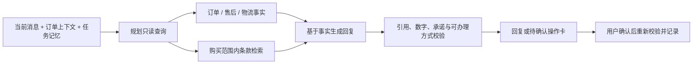

# 电商售后 Agent · V3.0

基于 LangGraph、RAG 和业务工具调用的中文售后 Agent，接入买家、店铺客服、平台客服三方工作台。

项目从订单内的一次咨询开始：理解用户遇到的问题，读取订单和已有售后，检索购买时适用的条款，再把可办理的动作交给用户确认。用户可以在聊天里改口、插问物流、补充凭证或继续办理，结果回到原售后单，由店铺和平台继续处理。

仓库自带 **50 位买家、100 家店铺、300 笔订单、4 笔案例订单**，用于复现业务与 Agent 链路。数据由项目生成，退款和物流结果在工作台内登记。

[部署说明](RELEASE_GUIDE.md) · [实现与评测记录](DEVELOPMENT_HISTORY.md) · [自动验收](.github/workflows/verify.yml)

## 为什么把 Agent 放进售后流程

售后对话不只有“问一句，答一条规定”。用户说“线找到了，但是鼠标不能用”，系统需要撤回缺件建议，保留新问题；用户查完物流继续问“那还能退吗”，系统需要知道是哪件商品、有没有正在处理的申请，以及适用哪个版本的条款。

本项目围绕这些连续任务实现四部分能力：

| 能力 | 实现重点 |
| --- | --- |
| 理解与规划 | 模型从当前消息、订单上下文与任务记忆提取诉求，选择只读查询；处理省略、插问、改口和多问题 |
| RAG | 按店铺及购买版本限定条款范围，三路召回、融合、窗口排序、引用核验，依据不足时有界补查 |
| 任务记忆 | 保存问题、处理意愿、件数、目标规格和凭证情况；区分用户描述、已上传凭证与已执行业务结果 |
| 工具执行 | 模型准备确认卡，用户确认后由业务接口重新核对状态与权限，以事务保存结果和审计 |

### 一次任务怎样走完

```text
买家描述问题 → Agent 结合当前订单与对话记忆理解诉求
             → 查询商品、物流、售后状态和购买时适用条款
             → 给出可执行建议，必要时准备确认卡
买家确认操作 → 业务系统再次校验资格、状态与版本 → 原单产生记录
店铺处理     → 买家协商或拒绝 → 满足条件时平台客服介入
```

买家先说“少了一根充电线”，再问“没拍开箱视频还能申请吗”，中途插问运费。规划器沿用当前商品与问题，工具核对资格和费用，生成器回答本轮问题。申请准备好后展示确认卡，买家点击才提交；店铺在自己的队列接到同一张售后单。

## 可以体验什么

| 角色 | 主要操作 |
| --- | --- |
| 买家 | 查订单与物流、咨询售后、提交申请、补充凭证、确认或拒绝店铺方案、登记寄回及新收货资料、查看进度 |
| 店铺客服 | 处理本店售后、提出协商方案、补充寄回信息、登记退款或补发换货 |
| 平台客服 | 查看符合条件的介入申请、核对三方记录、给出平台结论与复核 |

登录后可从“项目案例”进入三条连续路线：**缺件补发**（CN-410001）、**退款协商与平台介入**（CN-410002）、**同店同款不同购买条款**（CN-410003 / CN-410004）。案例说明与浏览器验收使用同一份 [场景清单](app/portfolio_cases.json)。

## Agent 架构



- **对话记忆**保存并存问题、改口、申请件数、凭证情况和暂停意愿；近期消息用于理解省略表达，不把旧助手措辞当成新事实。[代码](app/mall/dialogue_state.py)
- **查询与检索**先限定买家本人商品及购买时的店铺条款版本。条款召回结合词法、Milvus BM25 和 E5 稠密向量，融合排序后回到数据库核验原文；依据不足时最多进行一次有界补查。[规划](app/mall/agent.py) · [检索](app/policies/mall_retrieval.py) · [补查](app/mall/read_loop.py)
- **回复生成**读取结构化业务事实，再检查金额、状态、引用及承诺。模型或检索不可用时可降级，聊天里的“查看本轮查询”可看到实际路径；降级回复不能冒充模型结果。[事实](app/mall/tool_facts.py) · [生成](app/mall/grounded_reply.py)
- **办理确认**由 Agent 准备草稿，用户明确确认后，业务接口在事务中重新核对身份、状态和方案版本。重复确认返回同一回执；改口或店铺变更方案会使旧卡失效。[确认事务](app/storage/mall_chat_actions.py)

### 模型、规则与数据库各做什么

模型处理自然语言、选择查询和组织回答。资格、金额、权限和状态变化由业务规则核对，订单与办理结果由 PostgreSQL 保存。模型调用在业务事务之外进行，写入前重新检查版本，避免等待模型时长期持锁。

只读查询可以补查：条款依据不足时重写一次检索问题；读取原单后，可再决定是否查询退款、寄回、换补货包裹或协商方案。补查次数和范围有上限，不能换订单或执行写操作。

回复使用结构化事实，不靠拼接旧助手回复。数字、承诺、可申请方式和引用都要校验；部分费用与事实变更另作模型核对。失败时保留业务回退，并在查询轨迹里记录原因。

### 会话记忆与前端表单

记忆以商品会话和问题编号组织。近期六轮消息帮助理解上下文，已确认事实单独持久化，不因超过六轮被丢弃。同一商品可有多个问题，用户否定一项时不清掉所有诉求；查物流也不会自动恢复已暂停的办理。

自动识别结果可以填入售后原因与申请说明。用户自己编辑的说明由前端保护；改口会更新自动建议并使旧确认卡失效。聊天中声称“有照片”与实际上传照片分开记录，模型不能把口头描述当成已上传凭证。

### RAG 的检索范围与排序

平台底线、店铺条款与已审核补充条款分开管理。100 家店有自己的发布记录；订单按购买时的版本核对，店铺后续发布新条款不直接改写旧订单依据。

检索先按当前订单限定范围，再执行范围内词法、Milvus BM25 和 multilingual E5 三路召回。RRF 融合后，把窗口相似度名次与融合名次结合排序；窗口使用 E5，并非独立交叉编码器。最终候选必须回到订单数据库核验编号、版本和原文。

依据不足时，模型可根据缺失问点改写一次检索；若换了范围、丢了问点或结果变差，就保留首轮可信结果。检索命中也不直接等于可办理，仍需业务工具核对资格。

### 办理一致性

确认卡绑定当前任务及原单状态。用户改口、店铺修改方案或其他卡片已执行，都会使旧卡失效；重复请求返回同一回执。身份、方案版本、当前责任人和合法动作在事务内再次检查。

退货、退款、在途退回、换货和补发共享原售后记录。寄回地址由店铺提供，寄回运单由买家登记；换补货的新收货资料与原购买地址分开确认。平台介入沿用原单，三方可以查看处理历史。

### 技术栈与代码入口

| 层 | 技术 / 入口 |
| --- | --- |
| 页面 | React · [web/commerce](web/commerce) |
| 接口 | FastAPI · [app/api.py](app/api.py)、[app/mall/api.py](app/mall/api.py) |
| Agent 规划 | LangGraph / DeepSeek · [agent.py](app/mall/agent.py) |
| 任务记忆 | [dialogue_state.py](app/mall/dialogue_state.py) |
| 事实与生成 | [tool_facts.py](app/mall/tool_facts.py)、[grounded_reply.py](app/mall/grounded_reply.py) |
| 条款检索 | Milvus / E5 ONNX · [mall_retrieval.py](app/policies/mall_retrieval.py) |
| 原单与事务 | PostgreSQL · [postgres_mall.py](app/storage/postgres_mall.py)、[mall_chat_actions.py](app/storage/mall_chat_actions.py) |
| 部署与回归 | Docker Compose、unittest、真实 Chrome 浏览器流程 |

## 快速启动

先安装 Docker Desktop。在仓库根目录的 PowerShell 中运行：

```powershell
pwsh -File scripts/prepare_docker.ps1
docker pull postgres:17-alpine
docker pull registry-1.docker.io/milvusdb/milvus:v3.0.0
docker compose --profile workbench up -d --build --wait
```

打开 **http://127.0.0.1:8766/login**。配置脚本只在缺少 `.env` 时生成本机配置，不覆盖已有密钥。查看三个角色的随机登录口令：

```powershell
docker compose exec workbench python -X utf8 -B -m scripts.show_demo_login buyer-001
docker compose exec workbench python -X utf8 -B -m scripts.show_demo_login shop-001
docker compose exec workbench python -X utf8 -B -m scripts.show_demo_login staff
```

首次构建会下载并校验 E5 ONNX 模型。要体验模型规划与自然语言回复，在本机 `.env` 填入自己的 `DEEPSEEK_API_KEY`，再重建工作台容器；留空时使用规则降级。密钥、随机口令、数据库和下载模型**不在仓库中**。详细配置、源码启动方式、端口和限制见 [部署指南](RELEASE_GUIDE.md)。

## 验证与证据

```powershell
python -X utf8 -B -m unittest discover -s tests
python -X utf8 -B -m scripts.check_chat_actions
$env:MALL_BROWSER_JOURNEY = 'portfolio'
$env:MALL_DESKTOP_ONLY = '1'
node tests/browser/platform_review.mjs
```

浏览器验收使用临时账号和回滚事务。GitHub Actions 的 [Verify workbench](.github/workflows/verify.yml) 在新环境初始化工作台，运行 **296 项 Python 测试、聊天确认检查和完整浏览器案例**。独立空 Docker 卷首装的三角色、数据规模、Milvus 健康和 E5 推理记录在 [交付结果](scripts/fixtures/mall_docker_delivery_results.json)。

### 已有评测

| 检查内容 | 记录与范围 |
| --- | --- |
| Python / API | 当前 296 项；覆盖角色隔离、参数校验、会话与确认卡等 |
| 浏览器流程 | 缺件补发、协商拒绝与平台介入、不同购买版本；通过页面操作检查原单结果 |
| 多轮模型对话 | 场景提示调整后一批 28 段 / 91 轮，90 轮模型答复、1 轮业务回退；状态断言通过 |
| 检索对照 | 48 题中 41 题有原文标签，三路融合加窗口排序完整覆盖 37/41；另组 42 题中 36 题有标签，覆盖 35/36 |
| 公开售后语料 | QingshanAI 合成语料用于规划回归，记录中一次复测为 29/30；评价管理题未通过，当前没有该业务 |
| 并发与确认 | 双数据库连接竞争同一确认卡，检查单次业务写入与同一回执；另有 4 工作线程、20 会话的只读检查 |

检索对照使用 6 个购买范围的 300 段条款，加入 100 个相似干扰范围后共 5,300 条索引记录。干扰范围来自复制，不能算成新编写的条款；该基准集合也不代表每家店的实际语料量。

这些结果来自不同批次，详细分母、逐题结果和已知失误见 [开发记录](DEVELOPMENT_HISTORY.md)。问法已用于回归，不能称为未见盲测；状态断言不代替自由文本人工审核，小规模并发不代表生产吞吐。公开数据用于评测，没有微调模型权重。真实模型调用会产生 API 费用。

## 项目边界

这是可部署、可操作的作品，不是生产电商平台：没有真实支付退款、快递接口、外部商家身份认证或公网运维体系。请仅使用附带的虚构资料，不要把本机服务直接暴露到公网。仓库尚未附项目级 LICENSE；公开可读不等于已授予再分发许可。

