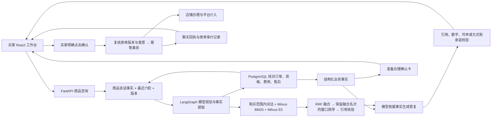
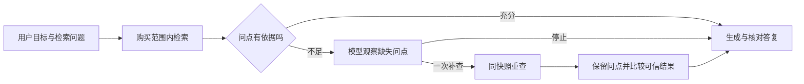

# 电商售后 Agent · V3.0

一个可现场操作的中文 AI 应用作品。买家可以问订单、查条款和申请售后，店铺可以处理申请，平台客服可以介入争议。项目自带 100 家虚构店铺、50 位虚构买家、300 笔商城订单和 4 笔案例订单。

本次交付增加原单观察后的只读补查、聊天登记运单与收货信息、按实时原单恢复会话，以及串行发布检查。当前自动化回归为296项；之前章节的数字是各批次历史结果。[场景回复验收](scripts/fixtures/mall_scenario_upgrade_results.json)、[条款补查验收](scripts/fixtures/mall_read_loop_results.json)与[业务任务验收](scripts/fixtures/mall_business_tasks_results.json)分别保留。

**部署入口：**[Docker Compose 与源码启动](RELEASE_GUIDE.md)说明整套应用容器、模型下载、验收和边界。[独立 Docker 空卷首装记录](scripts/fixtures/mall_docker_delivery_results.json)核对了三角色与数据规模。工作台只映射到本机，账号、订单和办理结果均为虚构或工作台内登记；不连接真实支付、快递和商家身份系统。公开源码不等于公网生产服务。

## 首次启动

推荐使用 [Docker Compose 整套启动步骤](RELEASE_GUIDE.md#docker-compose-启动整套应用)：准备 Docker Desktop 后运行 `pwsh -File scripts/prepare_docker.ps1`，再运行 `docker compose --profile workbench up -d --build --wait`。首次启动需先拉取 README 所列 PostgreSQL、Milvus 镜像；完整命令和账号查询见部署说明。Docker 工作台默认位于 `http://127.0.0.1:8766`。

如果要直接运行本机 Python 服务，准备 Python 3.14、Node.js 22、Docker Desktop。以下命令在项目根目录的 PowerShell 中执行。

```powershell
python -X utf8 -B -m scripts.init_workbench --prepare-config
python -m pip install -r requirements-dev.txt
npm ci --ignore-scripts
npm run build
docker pull postgres:17-alpine
docker compose up -d --wait --pull never postgres
python -X utf8 -B -m scripts.init_workbench
python -X utf8 -B server.py
```

打开 [本机工作台](http://127.0.0.1:8765)。账号索引是 `.local/mall-logins.json`。案例买家为 `buyer-001`，店铺为 `shop-001`，口令在 `.local/mall-directory-accounts.json`。平台账号为 `staff`，口令在 `.local/demo-accounts.json`。首次初始化自动生成随机口令。已有安装使用原来的 `.env` 和口令。要从第一步重走带期限的案例，可以使用独立的空库。

基础售后流程、订单查询和条款引用可以直接体验；这时聊天使用规则降级。完整 Agent 对话需在 `.env` 填写 `DEEPSEEK_API_KEY` 并重启：模型读会话事实、选择只读查询，再根据业务核对结果组织回复。三路混合检索还需按[部署说明](RELEASE_GUIDE.md#打开完整-agent-与检索链路)准备 E5 模型、CPU 依赖和 Milvus；缺少依赖时会降级。退款与物流事件由三角色在工作台登记。

## 从三个案例看功能

使用 `buyer-001` 登录，从本文打开 [项目案例](http://127.0.0.1:8765/mall/portfolio)。页面给出可复制的问法、操作顺序和直达订单。买家业务导航提供“我的订单”和“我的售后”。

| 案例 | 订单 | 验收内容 |
|---|---|---|
| 少了一根充电线 | CN-410001 | 同时问补发和拍照。追问依据、改口更新草稿，再完成店铺补发和买家确认收货。 |
| 退款协商与平台介入 | CN-410002 | 店铺提出部分退款，买家拒绝，平台支持恢复原流程。三方操作都可在原售后单核对。 |
| 同店同款的新旧条款 | CN-410003、CN-410004 | 比较购买版本和寄回报价。询问会员包邮时，缺少证据就说明无法核实。 |

也可以在鼠标咨询里发「找订单：编织充电线」，再问「这单退货要我出邮费吗？刚才那单还能退吗？」。助手先答当前商品，另一半问题等买家点选后继续。返回原对话，可以打开另一笔订单的答复。开通模型时，还可以按自然语言描述的月份和实付单价缩小候选。

## 架构与代码入口



- [查询规划](app/mall/agent.py) 在启用模型后为每轮自然语言选择只读事项，提取有买家原话支持的事实，并补全省略的检索问点。模型异常、未配置模型以及结构化表单预检仍使用规则。
- [会话记忆](app/mall/dialogue_state.py) 按问题编号保存并存问题、逐项解决、处理意愿、申请件数、目标规格、凭证持有情况与暂停状态；最近六轮只作上下文，确认事实不会因超出六轮而丢失。[语义咨询](app/mall/semantic_consultation.py) 将模型意图交给业务规则执行。[仓储](app/storage/postgres_mall.py) 在锁内重核身份、最新会话版本和业务状态，冲突时重新规划一次；模型网络等待在事务外。
- [事实工具](app/mall/tool_facts.py) 直接读取商品、资格、费用和原单字段，现代回复链路不再拆分旧答复句子来构造依据。[回复生成与校验](app/mall/grounded_reply.py) 根据这些字段组织文字，逐句检查引用、数字、申请选项和承诺；费用回复另做模型事实核对，失败时保留可定位的降级原因。
- [聊天办理](app/mall/chat_actions.py) 准备确认卡；[确认事务](app/storage/mall_chat_actions.py) 复用已有申请与原单操作接口。顾客确认前不执行，改口或方案变化会使旧卡失效；重复确认返回同一回执，旧卡与处理记录仍可查看。
- [主聊天检索](app/policies/mall_retrieval.py) 保留范围内词法、Milvus BM25、Milvus E5 三路结果，先用 RRF 融合，再将窗口相似度名次与融合名次合并。首次配置的 `MALL_PERSISTENT_DENSE=1`、`MALL_WINDOW_RERANK=1` 启用已实测方案；已有安装需核对这两个配置并重启。稠密与稀疏字段存于独立集合 `mall_policy_hybrid_e5_v3`，保留原集合。候选必须回到订单数据库快照核对编号和原文。短条款复用全文编码，长条款仍计算局部窗口。依赖中断时降级并定期重试恢复。
- [条款引用](app/policies/mall_citations.py) 在购买时适用的条款里比对证据。[售后接口](app/mall/api.py) 管理买家确认、店铺办理和平台介入。
- [案例清单](app/portfolio_cases.json) 与 [浏览器验收](tests/browser/platform_review.mjs) 共用固定案例。更多实验和早期实现记录见 [开发记录](DEVELOPMENT_HISTORY.md)。

## 复跑验收

```powershell
python -X utf8 -B -m unittest discover -s tests
$env:MALL_BROWSER_JOURNEY = 'portfolio'
$env:MALL_DESKTOP_ONLY = '1'
node tests/browser/platform_review.mjs
```

浏览器验收需要 Chrome，使用临时账号和回滚事务。Chrome 或 Python 安在其他位置时，可用 `MALL_TEST_CHROME` 和 `MALL_TEST_PYTHON` 指定路径。仓库自带 [GitHub Actions 验收配置](.github/workflows/verify.yml)。需要对预设的虚构问法补测真实模型时，可设 `MALL_LIVE_SMOKE=1` 和 `MALL_LIVE_WRITER=1`。

商城条款评测有自带语料和独立标注。下列命令跑词法基线，混合召回依赖及对照命令见 [开发记录](DEVELOPMENT_HISTORY.md#混合检索与重排对照)。

```powershell
python -X utf8 -B -m scripts.evaluate_mall_terms --lexical-only
```

此前复跑两组引用题共 39 道。扩词后的 BM25 和混合召回均命中 21 道有依据题，16 道无依据题均未误引。该数字衡量题集上的条款引用，与对话和业务办理的通过情况分别记录。

## 成熟版验收目标

V1.0 记录可从自带数据复现的业务基线。成熟版以买家能用日常语言完成售后为目标，验收同时覆盖对话效果和三角色业务结果。

V2.0 加入从聊天陈述提取问题、准备凭证和恢复申请草稿的验收。打开 CN-410002 的桌面集线器，说「打开是空盒，并且快递包装也压坏了」。原因应为少件漏发，说明应包含空盒和包装破损。继续问「那我这个可以申请售后吧」，刷新后确认说明仍在。可以换成「外包装压坏了」，核对助手是否先问商品本身情况。

少件、错件和质量问题分别展示凭证建议。买家可以继续补充材料、改口或修改申请说明。已在办理的商品会引导查看原售后单。产品流程参考公开资料中分类处理、按问题举证和原单维权的思路。[拼多多消费者保障](https://www.yangkeduo.com/home/customer/) · [抖音电商售后原因说明](https://school.jinritemai.com/doudian/wap/article/aJMpSJ7wvGDx)

用「我没拍开箱视频」验收同一商品的凭证追问，再用「这样还能提交吗」核对当前原因的可办理方式。模型会依据已有原因和凭证要求回答，而不是要求重新选择商品。改口会更新自动填写的草稿；买家手写的申请说明由前端保护，不被新的自动建议覆盖。

| 能力 | 放行条件 |
|---|---|
| 选对查询 | 按独立标注的日常问法验收意图。至少覆盖本单、购买历史、原物流、售后包裹、退款、运费及复合问题。目标是至少 100 道题、总体通过率 95% 以上，逐类保留错例。 |
| 多轮办事 | 跑通同款多单、候选无结果、改口、缺凭证、取消和重试。所有跨订单用例均核对实际读取的订单编号和原问题。 |
| 有依据地回答 | 运费、资格、退款和时效结果来自业务数据或对应版本条款。发布用例中出现一次串单、越权或虚构退款承诺即退回修正。 |
| 异常时能继续 | 测模型超时、参数无效、双击提交以及浏览器刷新后的恢复。报告区分模型调用和规则降级，并记录耗时。 |
| 新环境交付 | 新解包目录从空库完成三角色验收，源码、账号初始化、评测命令和典型失误可复查。 |

以下命令分别测本地规则和配置 DeepSeek 后的意图规划。评测仅使用自编问句，报告记录命中、误入的查询事项及耗时。查询执行、对话状态和售后办理由浏览器用例另行验收。

```powershell
python -X utf8 -B -m scripts.evaluate_agent_intents
python -X utf8 -B -m scripts.evaluate_agent_intents --live
```

2026-11-22 首批实测 18 道题。修复前 17 道通过，其中一题同时误触发了原包裹物流与换货物流。修复后复跑同批 18 道均通过。该批用于定位问题和回归，成熟版放行还需要扩大题量并保留独立验证集。

### 早期 V3.0 路由实验（旧链路）

真实 DeepSeek 路由按整组工具完全匹配计分。100 道开发题从 80 题提高至复测 98 题。另一组 106 题首次通过 95 题，纠错后复测通过 105 题。最后单独编写的 100 道日常问法首次通过 97 题，无模型回退，规划耗时 P95 为 1.675 秒。三道错例均多选了工具，涉及快递盒拍照、退件费用及原配送费用。该耗时仅覆盖规划。题目是项目作者编写的中文问法，尚无外部用户评审。

运行 `python -X utf8 -B -m scripts.evaluate_mall_acceptance --live --audit` 可重测最终题集。不同时间调用模型可能得到不同结果。逐题原始记录见 [V3.0 验收报告](scripts/fixtures/mall_v3_results.json)。多轮办理另由 Python 用例覆盖空箱、错件、质量问题、缺少凭证后继续申请、改口和草稿恢复，浏览器用例覆盖三角色办理过程。

使用感受也进入商品售后咨询。买家说“坐垫坐着不舒服”时，助手记录该商品的体验反馈并询问是否要查退货。买家中途查询人工介入，再问能否退货时，系统根据下单条款和原售后单核对，并在符合条件时带入买家原话。明确陈述的故障走质量问题流程。未确认的模型建议只接受紧邻一轮的确认。

配置 DeepSeek 后，可以用 `python -X utf8 -B tests/probe_product_experience.py --live` 复测多轮体验问法。浏览器以 `MALL_BROWSER_JOURNEY=product-experience` 验收聊天、刷新恢复、退货提交和商家接单。设置 `MALL_LIVE_SMOKE=1` 可以为预设体验问法使用真实模型。

### 公开售后语料实验

项目引入 [青山的电商售后维权训练语料](https://www.modelscope.cn/datasets/QingshanAI/ecom-after-sale-synthetic)。原文件保存于 `.local/datasets/ecom-after-sale-synthetic/`，下载命令核对官方 SHA256。997 条单轮合成数据含 `scene/user/bot/tone`，规范化去重后有 847 种用户问法。页面标注 Apache License 2.0，仓库内 `LICENSE.txt` 为作者自定义授权声明，允许用于训练、研究及产品研发，并限制整体转售或冒充真实独家数据。

审计按规则标出了 527 条含办理承诺或动作表达的回复、211 条含评价或补偿表达的回复、11 条含固定时间的回复，类别可能重叠。标记供人工复核。原客服回复中的补偿、处理时限和自动退款承诺需要根据实际订单重写。

本项目从用户问法中挑选 8 条，重新标注为工具选择示例，保存在 `app/mall/planning_examples.json`。示例与评测题按规范化问句检查交叉污染。模型只接收审核后的工具计划。业务金额、资格和实际操作仍由当前订单与购买条款决定。

55 条开发集的基线为 51/55，6 个示例为 50/55，8 个示例为 54/55。另 30 条独立验证题的基线和 8 示例方案均为 28/30，因此示例实验默认关闭。遗留错例包含“申请被拒绝”只查进度而遗漏介入查询、尺码标注不符的工具范围，以及评价修改诉求。评分针对项目重新标注的工具和原因，语料本身没有提供这些标签。这些实验使用上下文中的少量示例，参数微调需要另外选定可训练模型与训练环境。

在根目录执行以下命令，可下载原文件、检查数据或比较提示示例。输出文件使用新名称。

```powershell
python -X utf8 -B -m scripts.prepare_after_sales_corpus --download --out .local/evaluations/qingshan-audit-new.json
python -X utf8 -B -m scripts.evaluate_qingshan_corpus --final --out .local/evaluations/qingshan-baseline-new.json
python -X utf8 -B -m scripts.evaluate_qingshan_corpus --with-examples --final --out .local/evaluations/qingshan-examples-new.json
```

### 统一会话主链路验收（2026-11-23）

本轮完成会话事实、模型规划、依据生成、本人订单与售后查询、主聊天混合检索和多轮评测六项整合。开发组 12 段 36 轮，留出组 10 段 30 轮，均不提供固定标准客服答复，也不把这些问句放进提示词。每轮检查真实持久化状态、处理意愿、实际工具和依据；这类检查不能替代对自由文本的人工审阅。

本轮复跑 66/66 状态检查通过，64 轮使用通过校验的模型答复，2 轮保留业务答复；完整请求耗时中位数约 3.68 秒、P95 约 6.18 秒。另 17 轮真实模型浏览器对话全部采用模型答复，并跑通买家提交、商家查看、原单进度、跨商品和自然语言找单筛价。Python 回归为 236 项。[可公开的汇总与边界](scripts/fixtures/mall_dialogue_results.json)随源码保留，完整逐轮记录另存 `.local/evaluations/`。留出题在纠错后已作为回归使用，不能再称作未见题；以上耗时不代表大规模并发性能。

```powershell
# 实际调用模型与检索；临时订单和会话在事务结束后回滚，报告另存到 .local/evaluations。
python -X utf8 -B -m scripts.evaluate_mall_dialogue --retrieval --all

# 每一轮使用真实规划与生成，另验收申请送达店铺、原单进度和价格筛选。
$env:MALL_MODEL_DIALOGUE = '1'
$env:MALL_TEST_RETRIEVAL = '1'
$env:MALL_BROWSER_JOURNEY = 'semantic'
$env:MALL_DESKTOP_ONLY = '1'
node tests/browser/platform_review.mjs

# 公开语料最终留出题，只使用 user 字段，输出文件使用新名称。
python -X utf8 -B -m scripts.evaluate_qingshan_corpus --semantic --final --out .local/evaluations/qingshan-semantic-new.json
```

混合召回需要启动 `docker compose --profile policy-search up -d --wait --pull never`，并按[模型与 CPU 依赖准备](DEVELOPMENT_HISTORY.md#混合检索与重排对照)放置 E5 模型。缺少依赖时会降级；恢复后重试，展开聊天气泡的“查看本轮查询”可核对实际路径。证据窗口排序采用 E5 相似度，不是独立交叉编码器。正式业务金额与资格由规则和原单记录决定。

公开数据最终留出题在新版语义规划上实测 29/30，无模型回退。未通过题询问好评、差评修改，当前项目没有评价管理功能。公开合成数据没有用于训练模型权重。所有评测均为有限问法验证，不代表真实平台的全部业务、并发能力或不存在幻觉。

### 任务记忆与聊天办理（2026-11-23）

这一批将回复生成、任务状态与执行动作拆开：规划器读取当前商品、问题编号和近期用户消息，业务工具提供有类型的字段，撰写器只看到本轮必要事实。撰写器不再读取旧助手回复来接着拼话。费用、退款状态及事实撤回使用额外的模型核对；无效参数或暂时的规划请求故障最多重试一次。

记忆分别保存多个问题、逐项解决、申请件数、想换的规格、手头凭证和暂停办理。购买两件不会自动变成申请两件，配件数量也不能直接替代订单商品件数；照片或视频的口头说明不等于已上传。商品恢复正常与暂停办理分开处理，查物流不会恢复已暂停的意愿。

聊天可准备提交申请、接受或拒绝店铺方案、补证、撤回和申请平台介入等确认卡，具体动作以原单当前权限为准。确认时重新检查商品、期限、任务与方案版本，复用同一事务保存业务结果、审计事件和回执。重复请求返回同一回执；用户改口、店铺换方案或另一张卡已办理，旧卡会失效。收货地址、寄回运单等复杂表单仍在原售后单办理。

| 验证 | 实测与含义 |
|---|---|
| Python与API回归 | 269/269通过，包含角色隔离、参数篡改、旧卡失效、同类多问题、大编号精度、三路候选保留、编码复用及评测分母。 |
| 多轮联合评测 | 28段、91轮状态检查通过；88轮采用模型答复，3轮采用业务回退。中位4.07秒，P95约7.70秒。 |
| 浏览器与事务 | 完整三角色基线通过；本次持久化检索开启后，17轮语义咨询通过（16轮模型答复、1轮数字校验回退），7轮聊天办理通过（全部模型答复），覆盖插问运费、暂停恢复、双击、刷新、协商拒绝和同单平台介入。 |
| 数据库并发 | 独立验收库保留4笔订单，9组检查通过；两个不同PostgreSQL后端同时读到未确认卡，再竞争业务锁，最终同一回执、每单一次提交事件。 |
| 持久化检索对照 | 48题中41题有有效原文标签。三路融合加保留融合名次的窗口排序完整覆盖37/41，Milvus BM25为23/41，E5为34/41，旧双路RRF为33/41。 |
| 新增问法对照 | 另写42题，36题有有效原文标签。选定方案覆盖35/36，Milvus BM25为31/36，E5为35/36，旧双路RRF为34/36。问句没有加入提示词或检索扩词表。 |
| 检索默认策略 | 三路召回、RRF融合，再合并窗口名次与融合名次；窗口仍用E5，不是独立交叉编码器。 |

上述两组检索对照都实际查询 `mall_policy_hybrid_benchmark_v3`：6个购买范围共300段条款，另加100个相似条款干扰范围，共5300条索引记录，范围核验未发现越界。干扰范围复制原文，只用于隔离压力，不能算作新增原创条款。主工作台的 `mall_policy_hybrid_e5_v3` 另以真实订单快照核验，3家店6次查询都走通三路召回与窗口排序。它与基准集合的语料不同，订单可引用条数取决于其购买版本和已审核补充条款，不能用基准集合条数冒充每家店的实际条款数。

旧评测将6道空标签题误计入有原文题分母，已更正为41题；原始报告继续保留。两组共13道无原文题单列，不参与覆盖率分母，候选排名也不等于业务答复的拒答准确率。完整问点覆盖与91轮状态断言均不能替代自由文本人工审核。现在这些问法都已执行并公开，后续应称回归题，不能继续称未见题。

```powershell
# Python/API回归与真实数据库事务验收。后者默认全部回滚，不留新订单。
python -X utf8 -B -m unittest discover -s tests
python -X utf8 -B -m scripts.check_chat_actions

# 合并原66轮和新增25轮；真实模型费用以自己的API账号为准。
python -X utf8 -B -m scripts.evaluate_mall_dialogue --all --task-memory

# 只比较检索算法，不访问或写入Milvus。
python -X utf8 -B -m scripts.evaluate_policy_pipeline --offline

# 复用已写入的5300条索引；缺失范围会报错，不会偷偷改用空索引。
python -X utf8 -B -m scripts.evaluate_policy_pipeline --reuse-index
python -X utf8 -B -m scripts.evaluate_policy_pipeline --reuse-index --questions scripts/fixtures/mall_terms_questions_holdout.json

# 真模型、真实Chrome、三角色聊天办理。订单写入全部回滚。
$env:MALL_MODEL_DIALOGUE='1'
$env:MALL_TEST_RETRIEVAL='1'
$env:MALL_TEST_PERSISTENT_DENSE='1'
$env:MALL_TEST_WINDOW_RERANK='1'
$env:MALL_BROWSER_JOURNEY='task-actions'
$env:MALL_DESKTOP_ONLY='1'
node tests/browser/platform_review.mjs
```

如果使用本项目已有的独立验收库，可为Python脚本加 `--acceptance-db`，浏览器设 `MALL_ACCEPTANCE_DB=1`。执行确认事务入口从 [ChatActionCard](web/commerce/ChatActionCard.jsx) → [买家接口](app/mall/api.py) → [原子确认](app/storage/mall_chat_actions.py) → [现有业务仓储](app/storage/postgres_mall.py)。Milvus请求参数遵循[官方REST说明](https://milvus.io/docs/restful_api.md)。

本批[逐轮检查与验收汇总](scripts/fixtures/mall_task_execution_results.json)和[两组检索逐题对照](scripts/fixtures/mall_policy_pipeline_results.json)随源码保存，包含实际业务回退、已完成的授权写入与验证边界。双连接验收记录位于独立库 `after_sales_v3_release_20261122`，主工作台不会展示这4笔验收订单。

### 场景回复与交付收口（2026-11-23）

[回复提示装配](app/mall/reply_prompt.py)按当前事实类型选择物流、费用、凭证和办理约束，保留通用的身份、事实和执行边界。任务事实增加当前进展、缺少字段、已有件数和目标规格，避免插问后重问已知内容。复杂收货地址和运单仍在原单表单核对，不让模型自行提交。

条款查询逐问点记录最终引用检查结果，区分全部有依据、部分有依据和未找到依据；补充条款不能越过基础条款的费用权限。聊天“查看本轮查询”展示未覆盖的问题及实际条款查询耗时。生成、重写与额外事实审查共享12秒阶段预算，不是整个请求的响应时间保证。

按场景提示重整后，28段91轮状态回归通过，90轮模型答复、1轮业务回退；中位约3.47秒、P95约5.33秒。另写3段13轮连续对话复测通过，13轮模型答复，中位约4.43秒、P95约6.57秒。两个批次的问法不同，不能据此直接推算性能提升比例。之后新增多原因一致性边界，最终另由278项自动化及7轮真实模型浏览器办理验证。问法均已执行，后续属于回归题。

交付检查脚本 [check_release_unpack](scripts/check_release_unpack.py)从新解包目录初始化指名的独立空库，保留数据库与目录。该检查复用已安装的Python、Node依赖，不代表全新操作系统安装。复跑需指定一个尚不存在、已获授权的数据库，例如 `--database after_sales_delivery_20261124`；脚本不会覆盖或清空同名数据库。

已获授权的 `after_sales_delivery_20261123` 空库验收完成：新解包源码初始化50位买家、100家店铺、304笔订单和604条商品明细，完整三角色浏览器流程通过；新生成账号在实际配置的应用中分别登录成功。浏览器售后操作全部回滚，基础数据和解包目录保留。主工作台已重启，登录、React资源和聊天确认接口检查通过。

### 有界补查与答复质量（2026-11-24）

[只读补查](app/mall/read_loop.py)在首轮条款依据不足时，把原始用户问题、前次检索表达和各问点的支持状态交给模型。模型只能停止或重写一次检索，不得更换订单、调用写操作；查询仍限定同一购买快照。若重写丢失已知问点、换了范围、结果更差或模型失败，保留首轮可信结果。当前循环只覆盖条款查询，不是任意业务工具的自主循环。补查决策请求最多4秒，第二次查询启动前检查决策阶段预算；不构成端到端总耗时承诺。

[办理事实](app/mall/tool_facts.py)区分等待店铺提供寄回地址、买家填写快递公司及单号、买家核对售后收货信息。助手只解释原单当前所缺资料，实际提交仍由用户在原单核对；没有自动保存用户聊天中的地址或运单。



运行 `python -X utf8 -B -m scripts.evaluate_mall_dialogue --cases tests/evaluation_cases/scenario_task_dialogues.json --retrieval --persistent-dense --window-rerank --acceptance-db --audit` 可复测连续任务并额外审阅答复的相关性、事实依据和任务一致性。审阅不进入生产请求，状态通过率与审阅通过率分别记录；同一模型采用独立提示，不是独立外部评审。过程轨迹见聊天“查看本轮查询”。

### 业务工具与履约任务（2026-11-24）

原单查询补充一次有界观察决策：在本人商品范围先读取当前售后状态，再由模型决定是否补查退款、寄回、换补货包裹、店铺方案、运费或平台条件。最多追加3项只读事项；不接受订单编号或写操作参数。失败保留原查询。新增事项仍由原仓储在当前业务快照中执行，不由模型计算金额或更改权限。

买家可在聊天提供寄回的快递公司与运单号，或换补货的收件人、地址、电话。模型提取字段时必须有本轮买家原话，不能根据单号前缀猜快递公司。缺资料时只问缺项，齐全后展示可核对的确认卡；点击确认仍复用原 `ship`、`confirm_delivery_address` 操作、状态与版本校验，重复确认返回同一回执。用户需要修改卡中资料时继续在聊天纠正，旧卡随任务版本失效。

履约草稿绑定原售后单，确认后清除当前记忆中的已办理资料，历史审计保留。读取聊天历史时重新核对原单状态、当前责任人与可用动作，状态变化会让旧确认卡在展示时失效；历史执行回执保持原样。已有待发货包裹不再被解释为还等买家确认地址。

```powershell
# 发布检查串行执行，避免两套验收事务争用同一数据库。
python -X utf8 -B -m scripts.check_business_release
# 加入真实模型履约聊天，需要已配置的模型和Milvus；调用会产生API费用。
python -X utf8 -B -m scripts.check_business_release --live
```

发布检查使用既有独立验收库，不自动创建或清空数据库。外部公开合成语料本批首次规划复测28/30，补充通用包装留证规划后复测29/30；评价管理题仍未通过，项目未接入评价发布与修改，不能把该题算成功。该语料之前已用于回归，不是新的用户盲测。小规模并发验证使用4个并发工作线程、20个独立会话，同时核对本人读取和跨买家拒绝；不等于生产吞吐压测。

