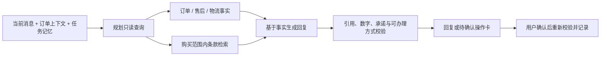

# 电商售后 Agent

> 一个能在同一笔订单里完成咨询、申请、协商与平台介入的中文售后工作台。买家、店铺客服、平台客服各有自己的入口和权限；Agent 负责理解问题、检索依据与准备操作，业务系统负责核对和执行。

这是求职作品，附带虚构商城数据，便于直接体验完整链路：**50 位买家、100 家店铺、300 笔订单，以及 4 笔串联场景的案例订单**。它不连接真实电商平台、支付或快递服务。

## 从一次售后开始

```text
买家描述问题 → Agent 结合当前订单与对话记忆理解诉求
             → 查询商品、物流、售后状态和购买时适用条款
             → 给出可执行建议，必要时准备确认卡
买家确认操作 → 业务系统再次校验资格、状态与版本 → 原单产生记录
店铺处理     → 买家协商或拒绝 → 满足条件时平台客服介入
```

例如买家先说“少了一根充电线”，再问“没拍开箱视频还能申请吗”，中途插问运费，助手应沿用**同一商品、已知问题与申请意愿**，而不是让买家重新选单。订单、费用、退款状态由数据库核对；模型不能自行决定金额，也不能替买家提交售后。

## 可以体验什么

| 角色 | 主要操作 |
| --- | --- |
| 买家 | 查订单与物流、咨询售后、提交申请、补充凭证、确认或拒绝店铺方案、登记寄回及新收货资料、查看进度 |
| 店铺客服 | 处理本店售后、提出协商方案、补充寄回信息、登记退款或补发换货 |
| 平台客服 | 查看符合条件的介入申请、核对三方记录、给出平台结论与复核 |

登录后可从“项目案例”进入三条连续路线：**缺件补发**（CN-410001）、**退款协商与平台介入**（CN-410002）、**同店同款不同购买条款**（CN-410003 / CN-410004）。案例说明与浏览器验收使用同一份 [场景清单](app/portfolio_cases.json)。

## Agent 如何工作



- **对话记忆**保存并存问题、改口、申请件数、凭证情况和暂停意愿；近期消息用于理解省略表达，不把旧助手措辞当成新事实。[代码](app/mall/dialogue_state.py)
- **查询与检索**先限定买家本人商品及购买时的店铺条款版本。条款召回结合词法、Milvus BM25 和 E5 稠密向量，融合排序后回到数据库核验原文；依据不足时最多进行一次有界补查。[规划](app/mall/agent.py) · [检索](app/policies/mall_retrieval.py) · [补查](app/mall/read_loop.py)
- **回复生成**读取结构化业务事实，再检查金额、状态、引用及承诺。模型或检索不可用时可降级，聊天里的“查看本轮查询”可看到实际路径；降级回复不能冒充模型结果。[事实](app/mall/tool_facts.py) · [生成](app/mall/grounded_reply.py)
- **办理确认**由 Agent 准备草稿，用户明确确认后，业务接口在事务中重新核对身份、状态和方案版本。重复确认返回同一回执；改口或店铺变更方案会使旧卡失效。[确认事务](app/storage/mall_chat_actions.py)

技术栈：**React、FastAPI、PostgreSQL、LangGraph、DeepSeek、Milvus、E5 ONNX、Docker Compose**。前端入口位于 [web/commerce](web/commerce)，API 在 [app/api.py](app/api.py)，商城业务仓储在 [app/storage/postgres_mall.py](app/storage/postgres_mall.py)。

## 五分钟找到入口

先安装 Docker Desktop。在仓库根目录的 PowerShell 中运行：

```powershell
pwsh -File scripts/prepare_docker.ps1
docker pull postgres:17-alpine
docker pull registry-1.docker.io/milvusdb/milvus:v3.0.0
docker compose --profile workbench up -d --build --wait
```

打开 **http://127.0.0.1:8766/login**。配置脚本只在缺少 `.env` 时生成本机配置，不覆盖已有密钥。查看三个角色的随机登录口令：

```powershell
docker compose exec workbench python -X utf8 -B -m scripts.show_demo_login buyer-001
docker compose exec workbench python -X utf8 -B -m scripts.show_demo_login shop-001
docker compose exec workbench python -X utf8 -B -m scripts.show_demo_login staff
```

首次构建会下载并校验 E5 ONNX 模型。要体验模型规划与自然语言回复，在本机 `.env` 填入自己的 `DEEPSEEK_API_KEY`，再重建工作台容器；留空时使用规则降级。密钥、随机口令、数据库和下载模型**不在仓库中**。详细配置、源码启动方式、端口和限制见 [部署指南](RELEASE_GUIDE.md)。

## 验证与证据

```powershell
python -X utf8 -B -m unittest discover -s tests
python -X utf8 -B -m scripts.check_chat_actions
$env:MALL_BROWSER_JOURNEY = 'portfolio'
$env:MALL_DESKTOP_ONLY = '1'
node tests/browser/platform_review.mjs
```

浏览器验收使用临时账号和回滚事务。GitHub Actions 的 [Verify workbench](.github/workflows/verify.yml) 在新环境初始化工作台，运行 **296 项 Python 测试、聊天确认检查和完整浏览器案例**。独立空 Docker 卷首装的三角色、数据规模、Milvus 健康和 E5 推理记录在 [交付结果](scripts/fixtures/mall_docker_delivery_results.json)。

检索对照、公开合成语料与多轮评测的逐项结果和局限见 [开发记录](DEVELOPMENT_HISTORY.md)。这些题已用于回归，不能称作未见盲测；公开数据没有用于微调模型权重。真实模型调用会产生 API 费用。

## 项目边界

这是可部署、可操作的作品，不是生产电商平台：没有真实支付退款、快递接口、外部商家身份认证或公网运维体系。请仅使用附带的虚构资料，不要把本机服务直接暴露到公网。仓库尚未附项目级 LICENSE；公开可读不等于已授予再分发许可。

